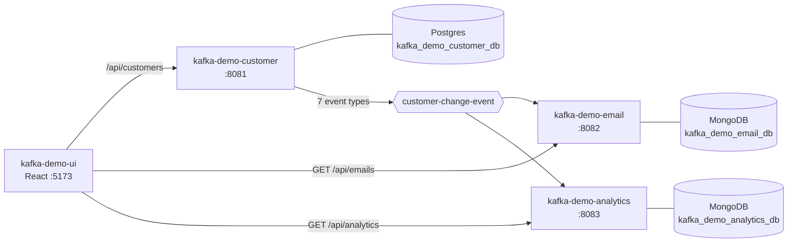

# Architecture

## The Kafka Demo system

| Repo | Role | Port | Data store |
|---|---|---|---|
| kafka-demo-customer | Owns customers and phones, publishes `customer-change-event` | 8081 | Postgres |
| kafka-demo-email | Sends an email for each customer change | 8082 | MongoDB |
| kafka-demo-analytics | Saves every event on `customer-change-event` | 8083 | MongoDB |
| kafka-demo-ui | React UI over all three | 5173 | — |
| local-docker | Kafka, Postgres, MongoDB, Keycloak for local dev | — | — |

## This service: kafka-demo-customer

Owns customer data in Postgres and publishes one event to `customer-change-event` for every API call that changes a customer or phone.

- **Produces:** `customer-change-event` (see [kafka-events.md](kafka-events.md))
- **Consumes:** —
- **Stores:** Postgres (see [erd.md](erd.md))

## Design decisions

- **One action service owns every change.** `CustomerChangeService` handles idempotency, works out what changed and
  publishes one event, changing data only through the CRUD service interfaces.
- **Publish after commit.** `CustomerEventPublisher` registers a transaction synchronization so the
  event is sent only after the change commits. If Kafka is down the customer is still saved and
  the failure is logged; there is no outbox yet, so that event is lost (see "Known gaps").
- **Email is unique, case-insensitively** — enforced by `ux_customer_email` on `LOWER(email)` and
  checked in `CustomerServiceImpl` to return a clean 409.
- **Idempotent producer** (`enable.idempotence=true`, `acks=all`).

## Known gaps

- No transactional outbox: an event can be lost if Kafka is unavailable at commit time.
- A crash between the commit and the publish also loses the event.
- Idempotency keys are never expired.
