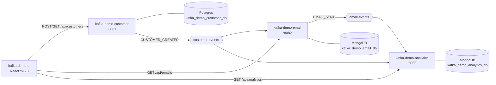

# Architecture

## The Kafka Demo system

| Repo | Role | Port | Data store |
|---|---|---|---|
| kafka-demo-customer | Owns customers, publishes `customer-events` | 8081 | Postgres |
| kafka-demo-email | Sends a welcome email per new customer, publishes `email-events` | 8082 | MongoDB |
| kafka-demo-analytics | Counts every event on `customer-events` and `email-events` | 8083 | MongoDB |
| kafka-demo-ui | React UI over all three | 5173 | — |
| local-docker | Kafka, Postgres, MongoDB for local dev | — | — |

## This service: kafka-demo-customer

Owns customer data in Postgres and publishes a `CUSTOMER_CREATED` event to `customer-events` for every new customer.

- **Produces:** `customer-events` (`CUSTOMER_CREATED`)
- **Consumes:** —
- **Stores:** Postgres

## Design decisions

- **Publish after commit.** `CustomerEventPublisher` registers a transaction synchronization so the
  event is sent only after the customer row commits. If Kafka is down the customer is still saved and
  the failure is logged; there is no outbox yet, so that event is lost (see "Known gaps").
- **Email is unique, case-insensitively** — enforced by `ux_customer_email` on `LOWER(email)` and
  checked in `CustomerServiceImpl` to return a clean 409.
- **Idempotent producer** (`enable.idempotence=true`, `acks=all`).

## Known gaps

- No transactional outbox: an event can be lost if Kafka is unavailable at commit time.
- Update and delete don't publish events; only `CUSTOMER_CREATED` exists.
- No Testcontainers integration tests yet; tests are unit and MVC slice tests.
