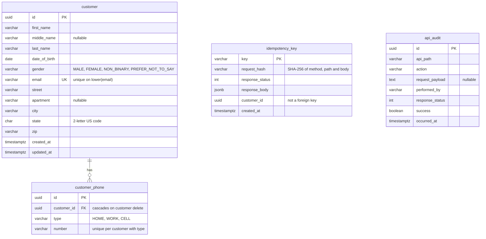

# Entity relationship diagram

kafka-demo-customer stores its data in PostgreSQL. It never uses the `public` schema.

| Table | Schema | Purpose |
|---|---|---|
| `customer` | `kafka_demo_customer` | Customers. The address is stored as columns because it is one-to-one. |
| `customer_phone` | `kafka_demo_customer` | A customer's phones. |
| `idempotency_key` | `kafka_demo_customer` | Stored results of POST requests. `customer_id` is not a foreign key because a key must outlive a deleted customer. |
| `api_audit` | `audit` | One row for every POST, PUT and DELETE, including denied ones. Not related to the other tables. |
